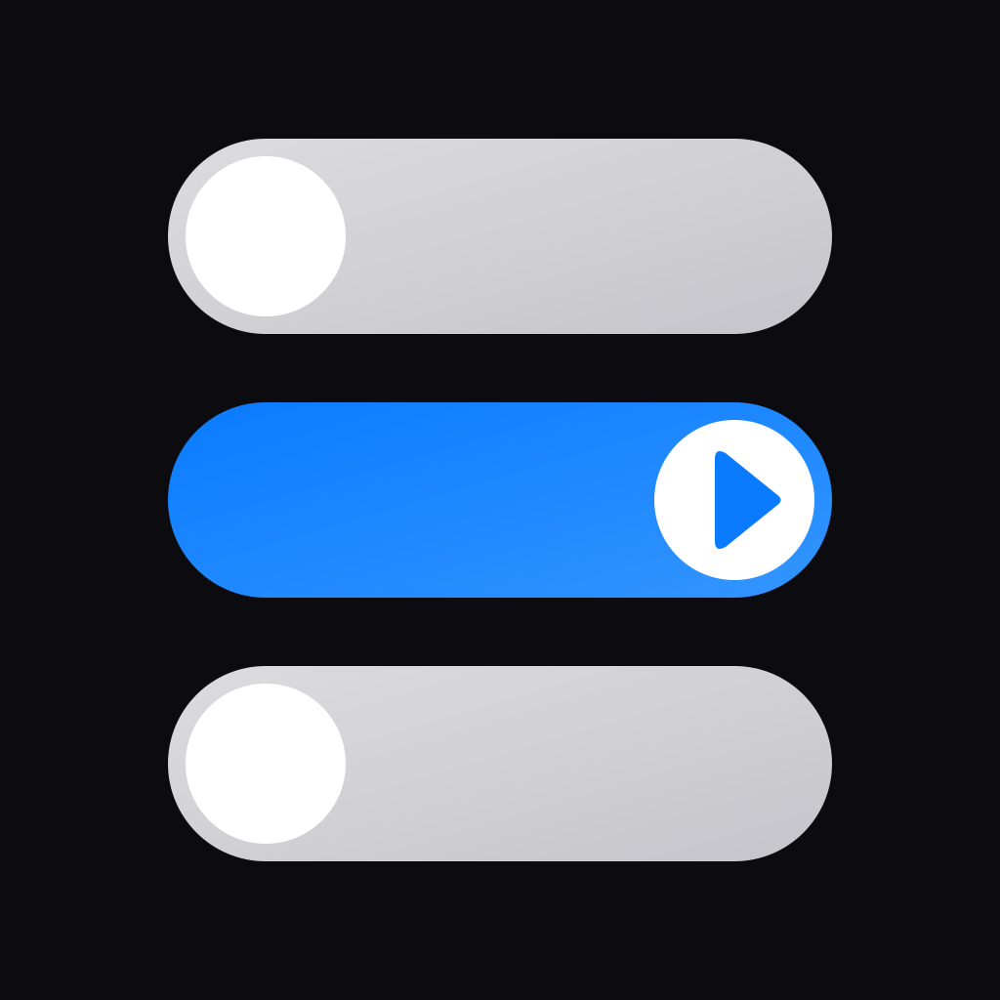

<p align="center"></p>

# Main Menu

A controller-first game launcher for iPhone, built for landscape. Add your games, tune how each one launches, and drive everything with a controller.

## Features

- Landscape-only SwiftUI app, designed around an iPhone 15 Pro
- Full controller navigation through the `GameController` framework
- Library browser with a searchable catalog of URL schemes, plus custom games
- Per-game launch method: URL scheme, Shortcut, or both with automatic fallback
- Settings for accent color, tile size, launch stats, haptics and start-on-last-played
- Everything stored on the device, nothing leaves it except the optional scheme list refresh

## Controls

| Input | Home | Library | Settings |
| --- | --- | --- | --- |
| D-pad or left stick | Move | Move | Move |
| A | Launch | Add, remove or edit | Change |
| X | Open Library | Switch Catalog and My games | |
| Y | Edit game | New custom game | |
| B or Menu | | Back to Home | Back to Home |
| LB and RB | Switch tab | Switch tab | Switch tab |

Touch works everywhere too. Text fields in the editor and the catalog search need the on-screen keyboard.

## Game art

Main Menu can fetch poster art for your games from [SteamGridDB](https://www.steamgriddb.com). Create a free API key at steamgriddb.com/profile/preferences/api, then open Settings, choose "SteamGridDB key" and paste it. Art is looked up by game name, shown on the Home tiles, and fetched again whenever you add a game. "Fetch game art" in Settings re-runs the lookup. The key and the image links stay on your device and are never part of this repository.

## Shortcut setup guide

Settings has a "Shortcut setup guide" screen with the four steps for the shared `Main Menu Launch` Shortcut, a button that installs a ready-made copy from iCloud, a button that opens Shortcuts to build it yourself, and a test button that runs it with the Settings app.

## External display

Plug the phone into a monitor over USB-C (or use AirPlay) and Main Menu renders its own full-screen version on the display, scaled up for the larger screen. While a display is connected, the phone goes to a black standby screen at minimum brightness and stays awake, which saves battery on the OLED panel. Tap the phone to wake it for 20 seconds, for example to use the keyboard. Turn this off with "Dim phone on display" in Settings. When you leave the app to start a game, brightness returns to normal and the display shows your game.

## How launching works

iOS doesn't let a sideloaded app launch other apps by bundle ID. Main Menu uses what is allowed:

1. **URL scheme**, for example `genshin://`. No banner and no extra app.
2. **One Shortcut for everything else.** Make a Shortcut named `Main Menu Launch` with a single action, Open App, and set its app to the Shortcut Input variable. Main Menu runs it with `shortcuts://run-shortcut?name=Main%20Menu%20Launch&input=text&text=<app name>`, so every game without a URL scheme works through the same Shortcut. Each game's "App name for the Shortcut" has to match the name under its icon on your Home Screen.

Most games don't register a URL scheme, so the shared Shortcut is the fallback. The catalog includes `genshin://`. Hollow Knight, Teamfight Tactics and Balatro start with their app names, which you can change in the editor.

## Build the IPA

1. Create a GitHub repository called `main-menu` and push this folder to `main`.
2. Open the Actions tab. The `Build IPA` workflow runs on every push, or you can start it by hand.
3. When it finishes, download `MainMenu.ipa` from the `latest` release (or from the run's artifacts).
4. In Feather, import the IPA (the release URL works) and sign and install it.

The workflow uses XcodeGen to generate the Xcode project from `project.yml`, then builds an unsigned archive and zips it into an IPA. Feather handles the signing.

## Project layout

```
project.yml          XcodeGen spec (bundle ID, landscape lock, icon)
Sources/             SwiftUI app
Resources/           Icon asset catalog and bundled scheme list
assets/              Logo source (logo.svg) and PNG
.github/workflows/   IPA build
```

To change the bundle ID, edit `PRODUCT_BUNDLE_IDENTIFIER` in `project.yml`.

## Credits

URL scheme data from [ios-uri-schemes](https://github.com/Semmelstulle/ios-uri-schemes) (CC BY 4.0). See `NOTICE.md`.
